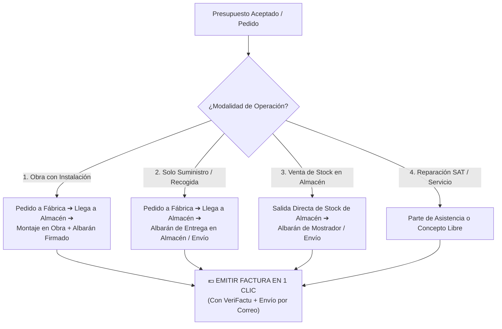
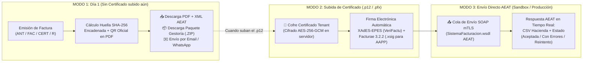
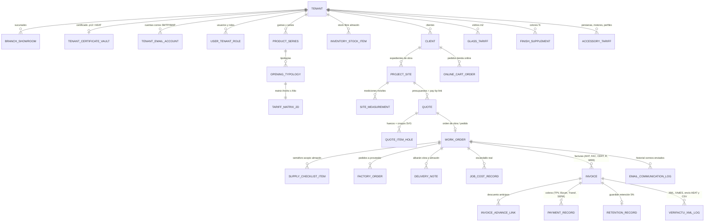

# 🏛️ PLAN MAESTRO DE ARQUITECTURA Y EXPANSIÓN — NOVA (Grupo Soto)

> **Versión:** `v4.1 — Especificación Integral Auditada + Reglas de Gobernanza IA (AGENTS.md)`  
> **Estado:** Diseño cerrado y blindado — **Listo para ejecución por etapas**  
> **Reglas de Ingeniería Activas ([`AGENTS.md`](AGENTS.md)):**
> - **Límite máximo de 500 líneas por archivo/componente** (división modular obligatoria en sub-componentes y servicios).
> - **Zero-Build en VPS:** Prohibido compilar o hacer deploy directo en el VPS de 4 GB de RAM; **todo despliegue pasa exclusivamente por GitHub Actions (`git push origin main`)**.
> 
> **Decisiones Estratégicas Base:**
> 1. **Marca Propia NOVA en Web Pública (Sin atar a marcas de terceros):** Especificaciones de ingeniería reales (CTE / UNE-EN / DIN) bajo nomenclatura propia de NOVA, manteniendo el fabricante real como dato dinámico interno en el backoffice (`supplierBrand`).
> 2. **Despliegue Flexible sin Subdominio Inicial (`novaventanasypuertas.com/portal` hoy ➔ `portal.novaventanasypuertas.com` o Nuevo VPS mañana):** El sistema funciona desde el Día 1 bajo `novaventanasypuertas.com/portal` y `/api/v1` (redirigiendo en Nginx al **puerto interno `3006`**, 100% libre en el VPS tras verificar que `3004` lo usa `electricidad-api` y `3005` lo usa `poseidon-backend`) con base de datos PostgreSQL aislada (`db_nova`). Todas las rutas y conexiones van por variables de entorno (`.env` / `environment.ts`) para que cuando se active el subdominio o se migre a otro VPS no haya que tocar ni una línea de código.
> 3. **Motor de Tarifas por Matriz de Medidas ($\text{Ancho} \times \text{Alto}$) + Casos Borde Reales:** Cuadrícula 2D en milímetros editable/importable desde Excel/CSV por el cliente, con soporte completo para fijos acoplados, cajones de persiana, tarifas con/sin vidrio base, croquis SVG visto desde el interior y suplementos técnicos.
> 4. **VeriFactu Evolutivo en 3 Fases (Sin Certificado Hoy ➔ Con Certificado `.p12`/`.pfx` y Envío Directo AEAT Mañana):** Huella `SHA-256`, QR oficial y descarga de XML/ZIP para gestoría desde el Día 1, con cofre de certificado digital y conector SOAP mTLS de la AEAT ya preparados para activarlos en 1 clic cuando se disponga del certificado.
> 5. **Arquitectura Lista para Venta Online / E-Commerce e Híbrida (`Pay-by-Link` + Tienda A Medida + Tienda Stock):** El mismo motor de precios y catálogo queda preparado para cobrar anticipos de presupuestos por enlace (Tarjeta/Bizum/Financiación) y para activar cuando se desee la venta online directa de ventanas a medida o productos en stock.

---

## 📑 ÍNDICE DE BLOQUES ARQUITECTÓNICOS

1. **[BLOQUE 1](#bloque-1-auditoría-de-la-web-pública-actual-y-correcciones-uxui-nav-formularios-y-contenido):** Auditoría de la Web Pública Actual (`src/`) — Fallos de Nav, Formularios, Contenido IA, Componentes en Reserva y Catálogos PDF.
2. **[BLOQUE 2](#bloque-2-lecciones-forenses-de-otros-portales-de-grupo-soto-lo-que-no-se-repetirá):** Lecciones Forenses de los otros Portales de Grupo Soto (Los 5 fallos de Riesgo/Facturación, Auth y Nav que quedan blindados en NOVA).
3. **[BLOQUE 3](#bloque-3-sistema-de-login-seguridad-zero-trust-multitenancy-y-matriz-de-roles):** Diseño Exhaustivo de Login, Seguridad Zero-Trust, Multitenancy Jerárquico y Matriz de 8 Roles.
4. **[BLOQUE 4](#bloque-4-navegación-del-portal-interno-sidebar-topbar-ctrlk-notificaciones-y-modo-móvil-de-obra):** Diseño Exhaustivo del Nav del Portal Interno (Sidebar, Topbar, `Ctrl+K`, Notificaciones y Modo Móvil de Obra Offline-First).
5. **[BLOQUE 5](#bloque-5-motor-de-precios-por-medidas-ancho-x-alto-y-todos-sus-casos-borde-de-carpintería):** Motor de Precios por Medidas ($\text{Ancho} \times \text{Alto}$), Fijos/Acoples, Dilema Vidrio Base, Persianas, Perfiles y Croquis Técnico SVG.
6. **[BLOQUE 6](#bloque-6-compras-a-fábrica-descuentos-de-proveedor-semáforo-de-acopio-y-escandallo-real):** Compras a Fábrica, Descuentos de Proveedor, "Semáforo de Acopio" en Almacén y Escandallo Real de Costes de Obra.
7. **[BLOQUE 7](#bloque-7-crm-autónomo-interno--conector-bidireccional-con-crms-y-erps-externos):** CRM Autónomo Interno + Conector Bidireccional Hexagonal (Webhooks, HubSpot, Odoo, Holded, Make/Zapier).
8. **[BLOQUE 8](#bloque-8-facturación-de-construcción-en-españa-y-arquitectura-verifactu-completa-descarga-hoy--certificado-y-envío-aeat-mañana):** Facturación de Construcción en España y **Arquitectura VeriFactu Completa (Descarga XML/ZIP Hoy ➔ Certificado `.p12` y Envío Directo AEAT Mañana)**.
9. **[BLOQUE 9](#bloque-9-preparación-nativa-para-venta-online--e-commerce-y-pasarela-de-pagos-omnicanal):** **Preparación Nativa para Venta Online / E-Commerce (`Pay-by-Link`, Configurador A Medida con Compra Online, Tienda de Stock y Logística)**.
10. **[BLOQUE 10](#bloque-10-esquema-de-base-de-datos-db_nova-estructura-de-carpetas-y-protocolo-de-migración-de-vps):** Esquema de Base de Datos (`db_nova`), Estructura de Carpetas y Protocolo de Portabilidad a otro VPS.
11. **[BLOQUE 11](#bloque-11-plan-de-ejecución-por-etapas-los-7-hitos-del-proyecto):** Plan de Ejecución por Etapas (Los 7 Hitos Secuenciales).

---

## 🔍 BLOQUE 1: Auditoría de la Web Pública Actual y Correcciones UX/UI (Nav, Formularios y Contenido)

La auditoría línea por línea de `c:\Proyectos\Grupo Soto\nova-ventanas-y-puertas\src` ha detectado los siguientes problemas exactos que resolveremos en la **Etapa 1**:

### 1.1. Fallos Detectados en la Navegación (`header.component` y `footer.component`)
1. **Enlaces del Menú Superior cruzados con secciones incorrectas (`header.component.html#L23-L29` y `L62-L83`):**
   - Hoy `VENTANAS` hace scroll a `#detalles` (que habla de ventanas, puertas y cerramientos), `PUERTAS` hace scroll a `#soluciones` (catálogo general), `SOLUCIONES` hace scroll a `#materiales` (los 4 materiales) y `NOSOTROS` hace scroll a `#showroom`.
   - **Solución:** Alinear los nombres del menú con las secciones reales:
     - `SOLUCIONES` ➔ `#soluciones`
     - `MATERIALES` ➔ `#materiales`
     - `GAMAS TÉCNICAS & CATÁLOGOS` ➔ `#catalogo-tecnico` *(sección refactorizada con las 6 gamas oficiales NOVA y descarga de los 4 PDFs)*
     - `PROYECTOS` ➔ `#proyectos`
     - `SHOWROOM` ➔ `#showroom`
     - Botón principal: `PRESUPUESTO` ➔ `#configurador`
     - **Nuevo enlace discreto profesional (en Header y Footer):** `🔒 Área Profesionales / Portal` ➔ `https://portal.novaventanasypuertas.com`.
2. **Secciones sin atributo `id` y corte de títulos por el Header fijo de 80px:**
   - `<app-architecture>` (`architecture.component.html#L1`) no tiene `id="arquitectura"` (rompiendo el enlace declarado en `src/llms.txt#L24`). `<app-brand-pillars>` tampoco tiene `id="valores"`.
   - 8 componentes usan `element.scrollIntoView({ behavior: 'smooth' })` sin compensar los `80px` del header fijo. Se añadirá `scroll-margin-top: 88px` global en `styles.scss` para todas las etiquetas `section[id]`.
3. **Enlaces legales externos y falta de textos propios en `novaventanasypuertas.com`:**
   - El Footer (`footer.component.html#L57-L61`) envía al usuario fuera del dominio (`gruposoto.es/aviso-legal`). Se incorporarán modales/vistas legales propias de **Grupo Soto Empresarial S.L.** y banner de consentimiento de cookies ligero.

### 1.2. Fallos Críticos en Formularios y Captación de Leads (`solution-finder`, `showroom`, `final-cta`)
1. **Cero persistencia actual (pérdida de Leads):**
   - `src/app/app.config.ts#L6-L8` ni siquiera tiene activado `provideHttpClient()`. Ningún formulario guarda datos en base de datos; todos dependen de que el usuario tenga WhatsApp instalado y pulse enviar manualmente.
2. **El Recomendador (`solution-finder.component.html`) no pide Nombre, ni Teléfono, ni Email:**
   - Solo pide la ciudad (`clientCity`).
3. **Bug en `nova.service.ts#L202-L264` (`getRecommendation`):**
   - De las 12 combinaciones posibles (`3 necesidades × 4 prioridades`), el diccionario solo tiene 7. Las otras **5 combinaciones** (`puerta-aislamiento`, `puerta-eficiencia`, `cerramiento-aislamiento`, `cerramiento-seguridad`, `cerramiento-eficiencia`) caen en el fallback `recommendations['ventana-diseno']` (`L263`), **recomendando una Ventana de Aluminio cuando el cliente ha pedido una Puerta o un Cerramiento**.
4. **Solución de Conversión Conectada al CRM (`POST /api/v1/public/leads`):**
   - Completar las 12 combinaciones reales en `NovaService`.
   - Añadir en el paso final del recomendador y en la reserva de cita de Showroom los campos: `Nombre/Empresa`, `Teléfono`, `Email`, `Localidad`, `Tipo de Obra (Reforma / Obra Nueva / Profesional)` y check RGPD, enviando el Lead directo al CRM de `portal.novaventanasypuertas.com` (y ofreciendo abrir WhatsApp como confirmación inmediata opcional).

### 1.3. Saneamiento del Contenido IA, Catálogos PDF y Componentes en Reserva
1. **Sustitución de Series inventadas por IA y promesas de subvenciones:**
   - Eliminar en `nova.service.ts` y `product.service.ts` los nombres ficticios (*"Nova Thermo 76"*, *"Nova Passiv 88"*, *"Nova Alu Minimal 70"*, *"Nova Horizon Slide"*, *"Master Gate RC3"*) y las promesas de *"hasta 4.000 € de subvención directa NextGen"*, sustituyéndolos por las **6 Gamas Técnicas Propias de NOVA** con parámetros reales del **CTE DB-HE / DB-HR y normas UNE-EN**.
   - Renderizar en `solutions.component.html` las propiedades `item.description` e `item.specs` que hoy están definidas en `nova.service.ts#L17-L58` pero no se muestran en el HTML.
2. **Publicación de los 4 Catálogos PDF Oficiales Traducidos (262 páginas):**
   - Hoy están en `document-pdf/traducidos/` fuera del build de Angular. Se copiarán/expondrán en `/assets/catalogs/` para descarga directa desde la web pública y desde el Portal Interno.
3. **Limpieza de los 6 Componentes en Reserva (`src/app/pages/home/components/`) y Servicios:**
   - **Rescatar y refactorizar a estética *Quiet Luxury*:**
     - `product-showcase`: Para mostrar las fichas técnicas de las 6 Gamas NOVA + botones de descarga de los 4 Catálogos PDF.
     - `testimonials-faq`: Integrar su acordeón de **5 Preguntas Frecuentes técnicas** (y su Schema JSON-LD `FAQPage`).
     - Muestrario de acabados (`finishColors`) de `showroom-gallery`: Integrarlo dentro de `app-materials`.
   - **Eliminar código muerto/roto:** Borrar `theme.service.ts` (huérfano), `nextgen-banner` y el resto de componentes duplicados con variables CSS obsoletas, además de limpiar el placeholder falso de `google-site-verification` en `src/index.html#L22` y el correo personal en `src/humans.txt#L4`.

---

## 🛡️ BLOQUE 2: Lecciones Forenses de Otros Portales de Grupo Soto (Lo que NO se repetirá)

La auditoría forense de `grupo-soto-automovil` y `serenity-wellness-center` ha identificado los **errores exactos de programación** que ocurrieron en producción para que `portal.novaventanasypuertas.com` nazca 100% blindado:

### 2.1. Los 5 Fallos que causaban el Bloqueo "Riesgo / Vencido / Impago" al pasar de Pedido a Factura
En `grupo-soto-automovil` se producía un bloqueo que impedía facturar pedidos de clientes al contado o a 30 días debido a estos 5 errores que **quedan prohibidos en NOVA**:

1. **Cortocircuito en la Máquina de Estados de la Tabla de Pedidos:**
   - En Automóvil, `if (isVencida || p.empresa?.bloqueadaPorRiesgo)` estaba en la posición #1 por encima del estado `ENTREGADO (FACTURAR)`. Si un cliente tenía cualquier marca de riesgo, **el botón `"Facturar"` desaparecía y era sustituido por `"Reclamar"` en todos sus pedidos**, impidiendo emitir la factura.
   - **Regla en NOVA:** El **Estado Operativo de Obra** (`EN_FABRICACION`, `EN_MONTAJE`, `INSTALADO`) y el **Estado de Facturación** son dos columnas independientes. **Jamás se oculta ni se bloquea el botón de Emitir Factura ni el de Registrar Cobro**, porque bloquear la emisión de una factura impide contabilizar y reclamar legalmente el trabajo realizado.
2. **El Bug de JavaScript `0 || 30` y el Vencimiento al Milisegundo (`new Date() < new Date()`):**
   - En Automóvil se programó `diasPago || 30` (convirtiendo a los clientes al contado con `diasPago = 0` en clientes a 30 días porque `0` es *falsy* en JS) y al comparar `new Date(fact.fechaVencimiento) < new Date()` con hora exacta, una factura emitida al contado a las `18:39:00.000` pasaba a ser "vencida" a las `18:39:00.001` (1 milisegundo después), bloqueando automáticamente al cliente en base de datos (`bloqueadaPorRiesgo = true`).
   - **Regla en NOVA:** Uso estricto de `diasPago ?? 0`, normalización de toda fecha de vencimiento a las **`23:59:59.999` del día de vencimiento**, y distinción entre `PENDIENTE_COBRO_CONTADO` (esperando transferencia/TPV) y `CREDITO_SEPA_VENCIDO`.
3. **Trampa Binaria de Estado de Cobro (`MARCAR_COBRADO` vs `MARCAR_IMPAGO`):**
   - En Automóvil no existía el estado intermedio `PENDIENTE_EN_PLAZO` al revertir un cobro: desmarcar una factura pagada la enviaba directamente a `IMPAGO` y bloqueaba la ficha de la empresa.
   - **Regla en NOVA:** Máquina de estados de cobro de **4 estados reales**: `PENDIENTE_EN_PLAZO` ➔ `COBRO_PARCIAL` ➔ `COBRADA_TOTAL` ➔ `IMPAGO_VENCIDO`.
4. **Bloqueo Ciego sin distinguir Forma de Pago:**
   - En NOVA, una alerta de riesgo crediticio solo restringe **lanzar pedidos a fábrica a crédito (giro 30/60 días) sin anticipo**, nunca operaciones con anticipo/transferencia pagada, y permite siempre el desbloqueo puntual autorizado y auditado por `GERENCIA`.

### 2.2. Errores de Login y Menú corregidos en la Arquitectura de NOVA
1. **En `JwtAuthGuard`:** Prohibido usar `jwtService.decode()` sin verificar firma criptográfica, prohibidos los secretos hardcodeados en código y prohibido el fallback a `SUPER_ADMIN` si un usuario es borrado. Verificación obligatoria de `user.isActive === true` y `user.tokenVersion === payload.tokenVersion`.
2. **Sincronización única de Estado y Menú:** Prohibido leer claves sueltas de `localStorage` en el Sidebar o BottomNav. Todo el árbol de navegación se alimenta de un único `AuthStore` con Angular Signals (`currentUser`, `activeTenant`, `activeBranch`, `activeRole`).

---

## 🔐 BLOQUE 3: Sistema de Login, Seguridad Zero-Trust, Multitenancy y Matriz de Roles

### 3.1. Multitenancy Jerárquico (`Grupo ➔ Tenant ➔ Sucursal/Showroom`)
El portal soporta múltiples empresas fiscales del grupo y múltiples centros operativos dentro de cada empresa:
- **Nivel 1 — Tenant (Sociedad Fiscal):** Ej. *NOVA Ventanas y Puertas (Grupo Soto Empresarial S.L.)*, o cualquier nueva sociedad/franquicia futura, cada una con su propio CIF, logo, series de facturación, certificados VeriFactu y tarifas.
- **Nivel 2 — Sucursal / Centro (`Branch`):** Ej. *Showroom Central Molina de Segura (La Serreta)*, *Showroom Murcia / Alicante*, *Nave / Taller de Almacenaje*.

### 3.2. Las 6 Pantallas y Flujos del Módulo de Acceso (`/auth/*`)
1. **Login Editorial (`/auth/login`):** Diseño *Quiet Luxury* (`#0D0D0D` y acentos Champagne `#C6AD82`), protección anti-fuerza bruta (`ThrottlerGuard`), `Access Token` (15 min en memoria reactiva) + `Refresh Token` rotativo (7 días en cookie `HttpOnly; Secure; SameSite=Strict`).
2. **Verificación 2FA (`/auth/2fa`):** TOTP (Google Authenticator) o código OTP por email para roles críticos (`SUPERADMIN`, `GERENCIA`, `ADMINISTRACION`).
3. **Recuperación y Cambio de Contraseña (`/auth/forgot-password` y `/auth/reset-password`):** Con invalidación instantánea de sesiones antiguas incrementando `tokenVersion++`.
4. **Activación de Invitaciones (`/auth/accept-invite`):** Para dar de alta empleados o **Arquitectos / Constructoras colaboradoras**.
5. **Selector Rápido de Tenant y Sucursal (en Topbar):** Permite a `SUPERADMIN` y `GERENCIA` alternar entre empresas o ver el consolidado global en 1 clic.
6. **Drawer de Perfil, Firma Digital Preconfigurada y "Modo Vistazo" (`Impersonation`):**
   - Cada comercial y medidor guarda su firma técnica para los PDFs.
   - `SUPERADMIN` y `GERENCIA` disponen de **"Modo Vistazo"** para ver la pantalla exactamente como la ve un Medidor, Instalador o Comercial sin cerrar su sesión.

### 3.3. Matriz Exacta de los 8 Roles de NOVA (`RBAC + ABAC`)

| Rol | Alcance | ¿Ve Costes Neto Fábrica y Márgenes? | ¿Aprueba Medición? | ¿Emite Facturas? | Módulos Visibles en el Nav |
| :--- | :--- | :---: | :---: | :---: | :--- |
| **`SUPERADMIN`** | Todos los Tenants y Sucursales | ✅ Sí | ✅ Sí | ✅ Sí | **Acceso Total (7 bloques)** + Configuración Multitenant, Integraciones y Auditoría Forense. |
| **`GERENCIA`** | Tenant activo (Todas las sucursales) | ✅ Sí | ✅ Sí | ✅ Sí | **Acceso Total al Negocio**: Cuadro de Mando, Rentabilidad Real por Obra, Desbloqueo de Riesgo, Tarifas y Facturación. |
| **`OFICINA_TECNICA`** | Sucursales asignadas / Global | ✅ Sí | ✅ Sí | ❌ No | Dashboard Técnico, Proyectos/Obras, **Presupuestador Técnico Avanzado**, **Validación de Mediciones**, **Pedidos a Fábrica** y **Catálogo/Tarifas 2D**. |
| **`COMERCIAL`** | Su cartera / Su Showroom | ⚠️ Solo PVP (y semáforo de margen permitido) | ❌ Solicita medición | ❌ Solicita facturación | Dashboard Comercial, **Embudo Kanban de Leads**, **Clientes**, **Presupuestador**, Agenda de Showroom y Seguimiento de sus Obras. |
| **`MEDIDOR_OBRA`** | Obras asignadas para medir | ❌ **OCULTO (0 € visibles)** | ✅ Firma medición | ❌ No | **Modo Campo Móvil Prioritario:** Mi Ruta de Mediciones, **Cuaderno de Medición por Huecos (mm + croquis + fotos)**, Planos y Firma en obra. |
| **`INSTALADOR_MONTAJE`** | Obras asignadas para montar | ❌ **OCULTO (0 € visibles)** | ❌ No | ❌ No | **Modo Campo Móvil Prioritario:** Mi Ruta de Montaje, **Checklist de Carga de Caballetes/Vidrios**, Fotos Antes/Después y **Albarán de Instalación con Firma en Pantalla**. |
| **`ADMINISTRACION`** | Tenant completo | ✅ Sí | ❌ No | ✅ Sí | Dashboard Financiero, Clientes y Riesgo, **Hitos de Cobro, Facturas (Anticipos, Finales, Certificaciones, Rectificativas)**, **Facturas de Proveedores (Escandallo)**, Remesas SEPA y **VeriFactu**. |
| **`ARQUITECTO_B2B`** *(Externo)* | Solo sus obras asignadas | ❌ Solo su PVP/Tarifa | ❌ No | ❌ Descarga las suyas | **Portal Partner:** Mis Proyectos, Aprobar Presupuestos online, Estado de Fabricación/Montaje y Descarga de **Catálogos PDF / Fichas CTE / BIM**. |

---

## 🧭 BLOQUE 4: Navegación del Portal Interno (Sidebar, Topbar, `Ctrl+K`, Notificaciones y Modo Móvil de Obra)

### 4.1. Estructura del Sidebar en Escritorio (7 Módulos Unificados)
1. **`📊 1. CUADRO DE MANDO`**: `Resumen Operativo (KPIs por rol)` | `Agenda Global (Showroom, Mediciones y Montajes)`.
2. **`🎯 2. CRM & COMERCIAL`**: `Pipeline Kanban de Leads` | `Clientes, Constructoras y Arquitectos` | `Presupuestos y Configurador por Huecos`.
3. **`📐 3. OFICINA TÉCNICA & OBRA`**: `Expedientes de Obra Activos` | `Cuaderno de Mediciones en Obra` | `Pedidos a Fábrica y Proveedores`.
4. **`🚚 4. ALMACÉN & MONTAJE`**: `Recepción de Material y Semáforo de Acopio (Caballetes)` | `Planificación y Partes de Montaje` | `Posventa, Garantías e Incidencias (SAT)`.
5. **`💶 5. FACTURACIÓN & COSTES`**: `Hitos de Cobro y Retenciones (5%)` | `Facturas Emitidas y VeriFactu` | `Facturas de Compra y Escandallo Real de Obra` | `Tesorería, Vencimientos y Control de Riesgo`.
6. **`📦 6. CATÁLOGO & TARIFAS 2D`**: `Gamas, Series y Tipologías de Apertura` | `Matrices de Precios Ancho x Alto (Editor + Importador Excel)` | `Tarifas de Vidrios, Colores, Persianas y Mano de Obra`.
7. **`⚙️ 7. SISTEMA & MULTITENANCY`**: `Usuarios, Roles y Cuadrillas` | `Empresas (Tenants) y Showrooms` | `Conectores CRM / Webhooks` | `Auditoría de Seguridad`.

### 4.2. Topbar Superior, Buscador Global (`Ctrl+K`) y Alertas Accionables
- **Selector de Contexto:** Empresa (`Tenant`) + Sucursal (`Showroom`) + **Chip de "Obra Fijada"** (permite fijar una obra en pantalla para que al cambiar entre Presupuesto, Medición, Pedido a Fábrica y Facturación todo esté filtrado automáticamente por esa obra).
- **Buscador Omnisciente (`Ctrl+K`):** Disponible para **todos** los trabajadores internos; busca al instante por Nº de Presupuesto (`PRE-2026-0042`), Nº de Factura, Nombre/CIF de Cliente, Dirección de Obra o comando rápido (`> nuevo presupuesto`).
- **Campana de Alertas Operativas:**
  - 🔴 *Obra lista para pedir a fábrica pendiente de cobro de Anticipo 50%.*
  - 📦 *Acopio 100% completado en Almacén (Caballete C-12) ➔ Lista para agendar montaje.*
  - 📞 *Presupuesto enviado hace 5 días sin respuesta ➔ Toca seguimiento comercial.*
  - 💶 *Retención del 5% de garantía de Constructora X cumple 1 año en 15 días ➔ Reclamar cobro.*

### 4.3. Modo Campo / Obra para Móvil y Tablet (`FieldWorkLayout`)
Diseñado específicamente para `MEDIDOR_OBRA` e `INSTALADOR_MONTAJE`:
- **Conmutador de 1 toque `☀️ Modo Exterior Alto Contraste`:** Cambia el fondo oscuro por marfil de alto contraste (`#F4F0E9` con texto `#0D0D0D`) para poder leer la pantalla bajo el sol directo en plena obra, con botones táctiles de `52px`.
- **Cola Offline-First (`IndexedDB`):** Si el medidor está en un sótano o obra sin cobertura, guarda las medidas y fotos en el teléfono y las sincroniza automáticamente al recuperar 4G/5G.

### 4.4. Continuidad Estética Web $\leftrightarrow$ CRM: Sistema de Diseño *Quiet Luxury Architectural ERP*
El estilo de [`src/styles.scss`](src/styles.scss) se trasladará íntegramente al CRM (`portal.novaventanasypuertas.com`) mediante un archivo maestro de tokens (`_nova-design-tokens.scss`) que conserva el ADN arquitectónico de la web adaptándolo para el trabajo intensivo de oficina y obra:

1. **Los 5 Pilares Visuales de la Web aplicados al CRM:**
   - **Geometría de Arista Viva (`border-radius: 0px`):** Todos los botones, inputs, modales, pestañas, tablas y tarjetas del CRM mantienen esquinas rectas a $90^\circ$ (inspiradas en los cortes a inglete de la perfilería de aluminio), diferenciándose de cualquier plantilla genérica.
   - **Tipografía `Manrope` con Números Tabulares (`font-variant-numeric: tabular-nums`):** Mantiene los títulos ligeros (`font-weight: 300/500`), las etiquetas superiores `.label-tracked` en mayúsculas (`0.72rem`, `letter-spacing: 0.20em`, color `--color-champagne: #C6AD82`) y activa `tabular-nums` en todas las tablas y matrices $\text{Ancho} \times \text{Alto}$ para que las columnas de milímetros y euros (`1.240,50 €`) queden alineadas al milímetro.
   - **Estructura por Líneas Arquitectónicas de `1px` (Cero Sombras Pesadas):** Al igual que `.finder-box` y `.arch-divider` en la web, los paneles del CRM se dividen con filetes limpios de `1px solid` (`#242424` en modo oscuro / `#DCD5C9` en modo claro).
   - **Estado Activo / Selección en Latón Cepillado (`#C6AD82`):** Tanto las opciones activas del Sidebar como las celdas seleccionadas en la matriz de medidas usan el patrón exacto de `.finder-pill--active` de la web (`border-color: #C6AD82` + fondo translúcido `rgba(198, 173, 130, 0.08)`).
   - **Semáforos de Estado "Minerales" (Sin colores neón estridentes):**
     - 🟢 *OK / En Almacén / Cobrado:* Verde Salvia Arquitectónico (`#4E8765` sobre `rgba(78, 135, 101, 0.12)`).
     - 🟡 *En Proceso / En Plazo:* Champagne NOVA (`#C6AD82` sobre `rgba(198, 173, 130, 0.12)`).
     - 🟠 *Aviso / Parcial:* Ámbar Cobre (`#C88A4B` sobre `rgba(200, 138, 75, 0.12)`).
     - 🔴 *Incidencia / Impago:* Terracota Óxido (`#B8544B` sobre `rgba(184, 84, 75, 0.12)`).

2. **Doble Tema Nativo con los Mismos Colores de `src/styles.scss` (Conmutador en Topbar):**
   Para que quien prefiera la estética negra del Showroom la disfrute, y quien pase 8 horas picando facturas o midiendo al sol tenga máxima legibilidad sin fatiga visual, el CRM invierte limpiamente los dos colores principales de la marca (`#0D0D0D` y `#F4F0E9`):

   | Variable en el CRM | 🌑 Tema **"Noir Showroom"** *(Idéntico a la Web)* | ☀️ Tema **"Warm Ivory"** *(Oficina / Sol en Obra)* |
   | :--- | :--- | :--- |
   | **Sidebar Lateral** | `#0D0D0D` con acento Champagne `#C6AD82` | `#0D0D0D` con acento Champagne `#C6AD82` *(Mantiene el marco negro de lujo)* |
   | **Fondo de Trabajo (`--bg-primary`)** | `#0D0D0D` (`--color-black`) | `#F4F0E9` (`--color-white-warm`) |
   | **Tarjetas y Tablas (`--bg-card`)** | `#141414` / `#171717` (`--color-black-surface`) | `#FFFFFF` / `#EBE5DC` |
   | **Líneas Divisorias (`--border-subtle`)** | `#242424` (`--color-black-border`) | `#DCD5C9` (Piedra cálida) |
   | **Texto Principal (`--text-primary`)** | `#F4F0E9` (`--color-white-warm`) | `#0D0D0D` (`--color-black`) |
   | **Texto Secundario (`--text-secondary`)** | `#A9A39A` (`--color-stone`) | `#655F56` |
   | **Acento Principal (`--color-champagne`)** | `#C6AD82` | `#9E8252` (Latón oscurecido para alto contraste sobre fondo claro) |

3. **Documentos PDF con el Mismo Estilo Editorial:**
   - Todos los PDFs generados por el CRM (Presupuestos, Pedidos a Fábrica, Albaranes y Facturas) usarán la misma cabecera en `#0D0D0D`, filetes en `#C6AD82`, tipografía `Manrope`, tablas a $90^\circ$ y croquis vectoriales SVG estilizados.

---

## 📐 BLOQUE 5: Motor de Precios por Medidas ($\text{Ancho} \times \text{Alto}$) y TODOS sus Casos Borde de Carpintería

Una tabla simple $\text{Ancho} \times \text{Alto}$ solo cubre una ventana aislada. El motor `pricing-engine` de NOVA contempla **todos los casos reales** que se dan a diario en presupuestos de ventanas, puertas y cerramientos:

### 5.1. Regla Base: Salto de Tramo en Matriz 2D ($\text{Ancho} \times \text{Alto}$)
- Para cualquier medida introducida en milímetros (ej. $1.140 \times 1.180\text{ mm}$), el motor localiza el primer tramo $\ge$ en la cuadrícula de la tipología elegida ($1.200 \times 1.200\text{ mm}$).
- Si la medida supera el máximo fabricable de esa apertura, la celda está vacía (`—`) y el configurador avisa en el acto sugiriendo añadir un fijo superior/lateral o cambiar a corredera elevable.

### 5.2. Caso Borde 1: Fijos Integrados (Travesaños) y Conjuntos Acoplados (Balconera + Ventana)
1. **Carpintería Partida en un Mismo Marco (`Travesaño / Montante`):**
   - Ejemplo: Ventana con **Fijo Inferior** (antepecho de seguridad) o con **Fijo Superior**.
   - Soporta tanto **Matriz Compuesta directa** como cálculo de **Matriz Base + Metro Lineal de Travesaño + Uniones**, obligando a indicar la cota exacta de partición (ej. `alturaFijoInferiorMm: 450`).
2. **Conjuntos Acoplados de Varios Marcos (`CompositeHoleGroup`):**
   - Ejemplo clásico: **Balconera acoplada a Ventana** en forma de "L" invertida, o grandes ventanales divididos en 2/3 módulos unidos en obra, o cerramientos en **Esquina a $90^\circ$ / Mirador (*Bay-Window*)**.
   - El sistema calcula cada sub-módulo en su matriz correspondiente y suma automáticamente el **Perfil de Unión / Acoplamiento** en metros lineales (`ACOPLE_SIMPLE_H`, `ACOPLE_ESTATICO_REFORZADO_CON_ACERO` para resistir presión de viento CTE DB-SE-AE, o `ACOPLE_ESQUINA_90`).

### 5.3. Caso Borde 2: $\text{Alto Total de Hueco}$ vs $\text{Alto Neto de Ventana + Cajón de Persiana}$
- Cuando un hueco lleva persiana Monoblock (cajón de $155\text{ mm}$, $185\text{ mm}$, $200\text{ mm}$ o $225\text{ mm}$), el presupuestador ofrece un selector claro:
  - **`Alto introducido = ALTO TOTAL (Incluye Cajón)`** *(por defecto en medición de obra)*: Si el hueco mide $1.400\text{ mm}$ y el cajón es de $185\text{ mm}$, calcula e imprime automáticamente:
    $$\mathbf{\text{Alto Carpintería: } 1.215\text{ mm} + \text{Cajón: } 185\text{ mm} = \text{ALTO TOTAL: } 1.400\text{ mm}}$$
  - **`Alto introducido = SOLO VENTANA (+ sumar cajón arriba)`**.
- Además, cada matriz permite configurar si busca por `CARPENTRY_NET_HEIGHT` ($1.215\text{ mm}$) o por `TOTAL_BLOCK_HEIGHT` ($1.400\text{ mm}$), adaptándose a cualquier fabricante.

### 5.4. Caso Borde 3: El Dilema de Tarifas "CON Vidrio Base ($4/16/4$)" vs "SIN Vidrio" y Reglas del Cristalero
En España unos fabricantes entregan matrices de precios **sin vidrio** y otros **con vidrio base $4/16/4$ incluido**. El motor de NOVA soporta ambos modos por serie (`glassPricingMode`):
1. **Modo `CARPENTRY_ONLY` (Matriz sin vidrio):** Suma el $100\%$ del precio del vidrio elegido.
2. **Modo `INCLUDES_BASE_GLASS` (Matriz con vidrio base incluido):** Si el cliente elige un vidrio superior (ej. *Bajo Emisivo + Control Solar Guardian Sun* o *Laminar Acústico*), el motor **descuenta automáticamente el precio de abono del vidrio base (`baseGlassCreditPerM2`)** y suma solo la diferencia; o descuenta el vidrio completo si se pide la ventana *"En Ciego (Sin vidrio)"*.
3. **Mínimo de Facturación de Vidrio ($0,50\text{ m}^2$) aplicado POR PAÑO / POR HOJA (no por hueco total):**
   - Una ventana de 2 hojas de $800 \times 800\text{ mm}$ ($0,64\text{ m}^2$ totales) lleva 2 vidrios independientes de $<0,32\text{ m}^2$; el motor aplica la regla real de todos los cristaleros: $2\text{ paños} \times 0,50\text{ m}^2 = 1,00\text{ m}^2$.
4. **Suplementos Técnicos de Vidrio, Peso en kg y Alerta CTE DB-SUA 2:**
   - **Gas Argón**, **Intercalar Térmico (*Warm-Edge / Swisspacer*)**, **Barrotillo en cámara**, **Veneciana integrada en cámara** y **Paneles Sándwich Ciegos**.
   - **Alerta automática CTE DB-SUA 2:** Si es balconera o fijo inferior a $<900\text{ mm}$ del suelo, avisa de obligatoriedad de vidrio **Laminar de Seguridad ($3+3$ / $4+4$)**.
   - **Calculador automático de Peso del Vidrio (kg) y Recargo Gran Formato (*Jumbo*):** Si un paño supera $2,5\text{ m}^2$ o $90\text{ kg}$ de peso, aplica el recargo de sobredimensión y avisa de necesidad de **Ventosa / Camión Grúa**.

### 5.5. Caso Borde 4: Persianas, Motores, Cajón de Obra Antiguo y Mosquiteras
- **Validación automática Lama de Seguridad $\leftrightarrow$ Motor:** Si se elige lama de aluminio autoblocante/extrusionada de seguridad, el sistema bloquea la cinta manual y exige motorización dimensionada en Newton-metro ($\text{Nm}$).
- **Persianas Partidas en un Único Cajón:** Soporta `1 Cajón continuo + 2 paños de lama con guía central doble y 2 motores` (típico de Balconera + Ventana).
- **Kit Renovación de Cajón de Obra Existente:** Para reformas donde no se pone cajón Monoblock sino que se sustituye lama, eje, motor y aislamiento dentro del cajón de obra antiguo.
- **Mosquiteras:** Enrollable integrada en guía doble, Plisada de $22\text{ mm}$ (para balconeras sin tropiezo), Corredera o Fija.

### 5.6. Caso Borde 5: Perfiles Adicionales, Premarcos y Medios Auxiliares
- **Tapajuntas / Solapes ($30\text{ a }100\text{ mm}$):** Cálculo exacto a **3 caras** ($2\text{ Altos} + 1\text{ Ancho} + \text{ingletes}$) o **4 caras**, por interior, exterior o ambas.
- **Prolongadores / Suplementos de Marco ($20\text{ a }100\text{ mm}$):** En cabecero, zócalo o laterales, descontando automáticamente su medida de la fabricación del marco.
- **Vierteaguas de Aluminio** (por desarrollo en mm + tapas laterales), **Premarcos** (con albarán de entrega anticipada en Fase 0 de obra), **Cintas de estanqueidad Passivhaus (*ISO-BLOCO*)**, **Amaestramiento de bombillos** (llaves igualadas), **Desmontaje + Canon RCD** y **Grúa / Andamios**.

### 5.7. Caso Borde 6: Mano de Apertura y Croquis Técnico Vectorial SVG (`VISTO DESDE EL INTERIOR`)
Para eliminar el error más caro del sector (fabricar una puerta o ventana que abre al lado contrario):
- Todo hueco exige definir su **Mano de Apertura (`Derecha`, `Izquierda`, `Activa Derecha + Pasiva Izquierda`, `Activa Izquierda + Pasiva Derecha`)** y **Sentido (`Interior` / `Exterior`)**, permitiendo además **Hojas Asimétricas** (ej. hoja de paso de $900\text{ mm}$ + hoja pasiva de $500\text{ mm}$).
- El servicio `WindowSketchSvgService` dibuja automáticamente un **Croquis Vectorial SVG a escala** con las líneas reglamentarias UNE-EN 12519, posición de la manilla, cajón de persiana, fijos y cotas, etiquetado siempre como **"CROQUIS VISTO DESDE EL INTERIOR DE LA VIVIENDA"** tanto en el Presupuesto PDF del cliente como en el Pedido a Fábrica.

### 5.8. Flujo Autogestionado: Cómo ellos mismos dan de alta su Catálogo y Tarifas (Sin programadores)
Para que el equipo de NOVA pueda añadir nuevas series, marcas o actualizar precios en minutos:
1. **Paso 1 — Alta de Serie / Producto:** Crean la serie, suben fotos y PDF técnico, indican sus valores ($U_w$, dB, mm), marcan con un interruptor si se muestra en la web pública (`showOnPublicWeb`) y cuál es su proveedor interno y descuento de compra (`-55%`).
2. **Paso 2 — Selección de Aperturas:** Activan con checks qué tipologías tiene esa serie (*1 Hoja, 2 Hojas, Balconera, Corredera, Fijo, Puerta*) o clonan las tipologías de otra serie existente en 1 clic.
3. **Paso 3 — Carga de la Matriz $\text{Ancho} \times \text{Alto}$ (3 métodos rápidos):**
   - **Pegar directo desde Excel (`Ctrl+C` / `Ctrl+V`):** Seleccionan las celdas en su Excel de tarifas y las pegan directamente sobre la cuadrícula del portal.
   - **Importar archivo `.xlsx` / `.csv`** con plantilla descargable.
   - **Edición manual en pantalla** celda por celda.
4. **Paso 4 — Actualización Masiva por Porcentaje (`+X%` Anual con Historial y Deshacer):**
   - Cuando un fabricante anuncia una subida general de tarifa (ej. $+4,5\%$ en enero), con un solo botón aplican `+4,5%` a todas las matrices de esa serie o proveedor, guardando una copia instantánea de la tarifa anterior por si quieren revertirla en 1 clic.
5. **Paso 5 — Simulador de Prueba Integrado:** Antes de activar la tarifa, prueban una medida en pantalla y ven el desglose completo (Precio Bruto ➔ Descuento Fábrica ➔ Coste Neto ➔ Margen NOVA ➔ PVP Cliente).

---

## 🏭 BLOQUE 6: Compras a Fábrica, Almacén, los 4 Circuitos hasta Factura y Escandallo Real

### 6.1. Cadena de Coste Neto de Fábrica vs PVP de Venta
Los fabricantes de carpintería aplican descuentos distintos según la familia del componente. El motor de NOVA calcula internamente:
$$\text{Precio Bruto Tarifa} \xrightarrow{-\text{\% Dto. Compra Proveedor (ej. -55\% Blanco / -50\% Color)}} \text{Coste Base} \xrightarrow{+\text{\% Recargo Energía}} \mathbf{\text{COSTE NETO NOVA}} \xrightarrow{\times \text{Margen / Multiplicador Tenant}} \mathbf{\text{PVP VENTA}}$$
*(Soportando que la perfilería lleve descuento sobre tarifa bruta mientras que el vidrio o los motores vayan a Precio Neto directo).*

### 6.2. Gestión de Almacén: Material de Obra (`Caballetes`) + Stock Libre de Almacén
El módulo de Almacén (`/portal/logistica/almacen`) gestiona dos tipos de inventario:
1. **Material Recibido por Pedido/Obra (`Semáforo de Acopio por Caballete`):**
   - Controla la llegada de la carpintería, los vidrios y las persianas de cada expediente, asignándoles ubicación física (`Caballete C-14` / `Zona B`) con etiqueta QR imprimible:
     - ⚪ `PENDIENTE_PEDIR` ➔ 🔵 `PEDIDO_EN_FABRICA` ➔ 🟠 `INCOMPLETO / ROTURA` ➔ 🟢 `100% EN ALMACÉN OK`.
2. **Stock Propio de Almacén (`InventoryStockItem`):**
   - Control de unidades disponibles en nave (motores Somfy, manillas, bombillos, espuma de poliuretano, silicona, cintas Passivhaus, ventanas de medida estándar) con **alerta de stock mínimo** para reposición.

### 6.3. Los 4 Circuitos Operativos hasta Factura (Con Obra vs. Directo desde Almacén)
No todos los pedidos requieren enviar montadores a una obra. El sistema soporta **4 caminos flexibles** para que puedan pasar a factura exactamente cuando corresponda:

- **Atajo Directo Almacén ➔ Factura (Circuito 2 y 3):** Cuando un pedido es de **"Solo Suministro / Recogida en Almacén"** (venta a un reformista, albañil o particular que se lo lleva o se le envía sin montaje), **en cuanto el material se marca como `RECIBIDO EN ALMACÉN` (o sale de stock), se habilita inmediatamente el botón `💶 Entregar y Pasar a Factura`**, sin obligar jamás a pasar por las pantallas de medición o cuadrillas de montaje.

### 6.4. Escandallo Real de Obra (`JobCostingSummary`)
Cada expediente cruza automáticamente el **Coste Previsto en Presupuesto** contra las **Facturas Reales de Proveedores + Horas Reales de Montadores + Medios Auxiliares + Costes de Postventa/Reposiciones**, mostrando a Gerencia el **Margen Neto Real (€ y %)** dejado por cada operación.

---

## 🤝 BLOQUE 7: CRM Autónomo, Conector Externo y Sistema Propio de Correos Electrónicos (Multi-Cuenta SMTP/IMAP)

### 7.1. CRM Autónomo Nativo (`INTERNAL_ONLY` desde el Día 1)
- Pipeline Kanban especializado en cerramientos: `1. Nuevo Lead` ➔ `2. Cita Showroom / Cualificado` ➔ `3. En Presupuestación` ➔ `4. Presupuesto Presentado (con alertas de seguimiento a 3/7/15 días)` ➔ `5. Aceptado / Pendiente Medición` ➔ `6. En Fabricación / Almacén` ➔ `7. Entregado / Instalado` ➔ `8. Perdido (con motivo analítico)`.

### 7.2. Conector Bidireccional en Caliente (`CrmSyncModule`)
- Todas las tablas (`Lead`, `Client`, `ProjectSite`, `Quote`, `Invoice`) incluyen `externalCrmProvider`, `externalCrmId`, `lastSyncedAt` y `syncHash` (prevención de bucles infinitos).
- **Salida (Outbound):** Cola `CrmSyncOutbox` con Webhooks firmados `HMAC-SHA256` en cada evento (`lead.created`, `quote.accepted`, `invoice.issued`, `invoice.paid`).
- **Entrada (Inbound):** Endpoints `/api/v1/integrations/webhooks/*` protegidos por API Key para conectar con **HubSpot, Odoo, Holded, Pipedrive, Make o Zapier**.

### 7.3. Gestor de Correos Electrónicos Propios (Multi-Cuenta SMTP / IMAP Configurable por Ellos)
Para que no dependan de un correo fijo de programación y puedan **añadir, gestionar y enviar desde sus propias cuentas de correo corporativas**:
1. **Alta Ilimitada de Cuentas de Correo en el Portal (`/portal/admin/correos` y en `Mi Perfil`):**
   - Pueden añadir sus propias cuentas de **IONOS, Microsoft 365 / Outlook, Google Workspace / Gmail o cualquier servidor SMTP/IMAP** con presets de configuración rápida:
     - **Cuenta de Presupuestos / Comercial (`info@...` / `presupuestos@...`):** Para el envío de presupuestos y confirmaciones de citas en Showroom.
     - **Cuenta de Administración / Facturación (`facturacion@...` / `administracion@...`):** Para el envío de Facturas, Anticipos, Recibos y el paquete trimestral `.ZIP` a la gestoría.
     - **Cuenta de Compras / Fábrica (`compras@...` / `tecnico@...`):** Para enviar las Hojas de Pedido en PDF directamente a las fábricas de ventanas y cristalerías.
     - **Cuentas Individuales por Comercial / Usuario (`carlos@novaventanasypuertas.com`, etc.):** Cada trabajador puede vincular su propio correo y configurar su **Firma HTML corporativa con logo y teléfono**, de modo que cuando envía un presupuesto a su cliente sale desde su dirección personal y se guarda copia en su carpeta `Enviados` vía IMAP.
2. **Seguridad y Botón de Prueba Instantánea:**
   - Contraseñas de correo cifradas en base de datos (`TenantEmailAccount`) con `AES-256-GCM` y botón **`⚡ Probar Conexión y Enviar Email de Prueba`** para verificar al instante que las credenciales SMTP/IMAP son correctas.
3. **Editor de Plantillas de Correo (`EmailTemplate`) y Trazabilidad en cada Expediente (`EmailLog`):**
   - Plantillas editables con variables (`{{nombre_cliente}}`, `{{numero_documento}}`, `{{importe}}`, `{{boton_firmar_y_pagar}}`) para Presupuestos, Pedidos a Fábrica, Aviso de *"Su pedido ya ha llegado a nuestro almacén"*, Facturas y Recordatorios de vencimiento.
   - Dentro de cada Cliente, Presupuesto, Pedido o Factura, una pestaña **`📬 Historial de Correos`** muestra todos los emails enviados y recibidos con fecha, hora, cuenta emisora, PDF adjunto y estado de entrega/lectura.

---

## 💶 BLOQUE 8: Facturación de Construcción en España y Arquitectura VeriFactu Completa (Descarga Hoy ➔ Certificado y Envío AEAT Mañana)

### 8.1. Facturación Multi-Anticipo ($50\% \rightarrow 30\% \rightarrow 20\%$) y Liquidación Final Automática
- Soporta emitir 1, 2 o $N$ **Facturas de Anticipo** (`Serie ANT-2026-XXXX`) a medida que avanza el expediente.
- Al terminar el montaje, la **Factura Final de Liquidación** (`Serie FAC-2026-XXXX`) consolida el $100\%$ de la obra ejecutada y **resta automáticamente las bases imponibles y cuotas de IVA de todos los anticipos previos (`InvoiceAdvanceLink`)**, cobrando únicamente el saldo pendiente sin duplicar IVA.

### 8.2. Modificados y Extras de Obra (`Anexos / Change Orders`)
- Una vez aceptado un presupuesto y emitido su anticipo, el presupuesto principal queda protegido contra ediciones destructivas.
- Si el cliente pide en obra añadir un motor o cambiar un acabado, se pulsa **`+ Crear Anexo de Obra (`PRE-2026-0100-A1`)`**. Al emitir la Factura Final de Liquidación, el sistema suma automáticamente el Presupuesto Principal + los Anexos aprobados menos los Anticipos.

### 8.3. Retenciones de Garantía del 5% a 1 Año y el "Guardián de Retenciones"
- Para obras con constructoras/promotoras, soporta tanto **Retención Financiera después de impuestos** como **Retención Fiscal en base**, y registra cada retención en el **Guardián de Retenciones (`RetentionRecord`)**, lanzando una alerta automática a los 350 días del acta de recepción para reclamar la devolución de ese $5\%$.

### 8.4. Los 3 Regímenes de IVA en Construcción y el Calculador de la Regla del 40%
1. **`21% IVA General`:** Obra nueva estándar, locales comerciales o venta de ventanas sin instalación.
2. **`10% IVA Reducido en Reformas de Vivienda (Art. 91.Uno.2.10º LIVA)`:**
   - **Calculador Fiscal Automático de la Regla del 40% (`Tax40PercentRuleBadge`):** Comprueba en tiempo real según doctrina de la DGT que el **Coste Neto de Adquisición de los Materiales aportados por NOVA no supere el 40% de la Base Imponible total del presupuesto**. Si supera el $40\%$, avisa en pantalla antes de emitir para desglosar correctamente las partidas de servicios/instalación o pasar al $21\%$.
   - **Declaración Responsable en PDF:** Genera automáticamente el anexo legal para firma digital del propietario acreditando vivienda particular con más de 2 años de antigüedad.
3. **`0% Inversión del Sujeto Pasivo (Art. 84.Uno.2º.f LIVA)`:**
   - Valida automáticamente que el cliente sea empresario/profesional y que **incluya instalación en obra** (bloqueando el $0\%$ si es mero suministro de material sin montaje, ya que la ley obliga al $21\%$ en entregas de bienes sin instalación), generando la comunicación firmada del contratista.

### 8.5. Modo Subvenciones de Eficiencia Energética (Deducción IRPF 20%–40%–60% / Ayudas)
- Cuando se marca una obra con `isEnergyGrantProject = true`:
  - Exige e imprime en factura la **Referencia Catastral** del inmueble, la **Tabla de Transmitancia Térmica ($U_w$, $U_f$, $U_g$) y Permeabilidad Clase 4 (UNE-EN 12207) con Marcado CE**, y **bloquea cobros en efectivo** (obligatorio pago trazable por ley).

### 8.6. Arquitectura VeriFactu Evolutiva en 3 Modos (RD 1007/2023 + Orden HAC/1177/2024)
Como ahora mismo aún no está instalado el certificado digital definitivo, el motor VeriFactu de NOVA se construye con **3 modos evolutivos intercambiables desde el panel de administración sin tocar código**:

1. **MODO 1 — Operativo desde el Día 1 (Sin Certificado Digital subido: Conservación + Descarga + Envío Manual/Gestoría):**
   - **Encadenamiento Criptográfico Inmutable `SHA-256` oficial:** Cada factura emitida o rectificativa calcula su huella exacta según la especificación técnica de la AEAT (`IDEmisorFactura + NumSerieFactura + FechaExpedicion + TipoFactura + CuotaTotal + ImporteTotal + HuellaAnterior + FechaHoraHusoGenRegistro`), vinculándola con el hash de la factura anterior y bloqueando cualquier borrado o alteración.
   - **Código QR Tributario Oficial en PDF:** Imprime en la factura el QR oficial con los parámetros tributarios para cotejo.
   - **Descarga y Envío en 1 Clic desde la Tabla de Facturas:**
     - **`📥 Descargar Factura PDF`** y **`✉️ Enviar Factura al Cliente (Email / WhatsApp)`** con registro de fecha/hora de envío y lectura.
     - **`📄 Descargar XML Oficial VeriFactu (`RegistroAlta` / `RegistroAnulacion`)`:** Genera y descarga el archivo `.xml` estructurado exactamente según el esquema oficial `SuministroLR.xsd` de la AEAT, listo para conservar o presentar manualmente.
     - **`📦 Descargar Cierre Trimestral / Mensual para Gestoría (`.ZIP`)`:** Genera un paquete comprimido con:
       1. Todos los PDFs de facturas emitidas y recibidas del periodo.
       2. Libro Registro de Facturas Expedidas y Recibidas en **Excel (`.xlsx`) y CSV** listo para importar en el software contable de la asesoría (A3, Sage, Contasol, Holded, Odoo).
       3. Todos los archivos `.xml` de registro VeriFactu del trimestre + **Informe de Auditoría de Integridad de la Cadena `SHA-256`**.
2. **MODO 2 — Cofre de Certificado Digital (`.p12` / `.pfx`) y Firma `XAdES-EPES` / `Facturae`:**
   - En `/portal/admin/tenants` queda lista la sección **"Certificado Digital y Conexión AEAT"** (`TenantCertificateVault`).
   - Cuando tengáis el certificado digital (`.p12` o `.pfx` de FNMT / Camerfirma), se sube desde el navegador y su clave privada se guarda cifrada con **`AES-256-GCM`**, mostrando aviso de renovación 30 días antes de su caducidad.
   - En cuanto hay certificado activo, el sistema firma automáticamente los XML con **`XAdES-EPES`** y habilita además el botón **`🏛️ Descargar Facturae 3.2.2 (.xsig)`** (por si NOVA realiza obras para un Ayuntamiento, Colegio Público o Administración vía **FACe**, y para cumplir la futura factura electrónica B2B de la **Ley Crea y Crece**).
3. **MODO 3 — Envío Directo y Automático a la AEAT en Tiempo Real (WebService SOAP `mTLS`):**
   - Selector en el panel: `Desactivado (Solo Descarga)` ➔ `Entorno de Pruebas AEAT (Sandbox)` ➔ `Producción Real AEAT`.
   - Al activarlo (o al pulsar el botón **`📤 Enviar a AEAT`** en una factura o lote de facturas), el backend conecta mediante el certificado del Tenant al servidor de Hacienda, guarda el **Código Seguro de Verificación (`CSV`)** devuelto por la AEAT y gestiona reintentos automáticos si los servidores de Hacienda están en mantenimiento.

---

## 🛒 BLOQUE 9: Preparación Nativa para Venta Online / E-Commerce y Pasarela de Pagos (`Omnicanal`)

Toda la base de datos (`db_nova`), el catálogo y el motor de precios por medidas ($\text{Ancho} \times \text{Alto}$) quedan diseñados para que, cuando queráis abrir el canal de **Venta por Internet o Cobro Online**, se active mediante configuración en **3 niveles progresivos**:

### 9.1. Nivel 1: Cobro Online de Presupuestos y Anticipos mediante Enlace (`Pay-by-Link`)
- Sin necesidad siquiera de abrir un carrito público en la web, cuando un comercial envía un presupuesto (`PRE-2026-0045`), el cliente recibe un enlace seguro donde puede:
  1. Ver el presupuesto interactivo con sus croquis SVG y **firmarlo digitalmente** en la pantalla de su móvil.
  2. Abonar en ese mismo instante el **Anticipo (ej. 50%)** mediante **Pasarela TPV (Redsys / Stripe: Tarjeta, Apple Pay, Google Pay, Bizum)** o solicitar **Financiación instantánea en cuotas (Sequra / Klarna / Aplazame)**.
  3. **Automatización Total:** Al confirmarse el pago por Webhook de la pasarela, el sistema registra el cobro, **emite automáticamente la Factura de Anticipo (`ANT-2026-XXXX`) con su huella VeriFactu**, la envía por email al cliente y pasa la obra a estado `ANTICIPO_COBRADO — LISTA PARA FABRICAR`.

### 9.2. Nivel 2: Configurador Web A Medida con Compra Online Directa ("Diseña y Compra tu Ventana Online")
- Dado que el endpoint `POST /api/v1/pricing/calculate-hole` ya calcula al céntimo cualquier ventana sobre la Matriz 2D ($\text{Ancho} \times \text{Alto} + \text{Color} + \text{Vidrio} + \text{Persiana}$), cada serie del catálogo incluye un flag `allowDirectOnlinePurchase: boolean` (`false` hoy, activable a `true` cuando se desee).
- Si se activa para determinadas series (ej. *Ventanas PVC 70/82 mm*, *Mosquiteras a medida*, *Mallorquinas*):
  - El visitante en `novaventanasypuertas.com` introduce sus medidas exactas en milímetros, ve el **Croquis SVG y el Precio Exacto en vivo**, elige entre **`Solo Envío a Domicilio en Toda España (Suministro)`** o **`Con Instalación Profesional (Murcia / Alicante)`**, lo añade al **Carrito (`OnlineOrderCart`)** y paga online.

### 9.3. Nivel 3: Tienda Online de Productos Estándar / Stock y Accesorios (`B2C` y `B2B Instaladores`)
- Soporte en catálogo (`ProductStockItem`) para vender online artículos que no requieren matriz de medidas o que tienen medidas estándar de almacén:
  - Ventanas de medida estándar en stock (entrega rápida), motores de persiana y domótica Somfy, manillas de seguridad/ocultas, bombillos antibumping, cintas de instalación Passivhaus o kits de limpieza y mantenimiento de carpintería.

### 9.4. Logística de Envíos Pesados y Blindaje Legal de Venta Online A Medida
1. **Motor de Portes por Zona, Peso y Embalaje (`ShippingZoneRule`):**
   - Enviar ventanas con vidrio por agencia de transporte requiere paletización especial o caballete. El sistema permite definir tarifas de envío por provincia/código postal según peso total (calculado automáticamente por la fórmula de peso de perfilería + vidrio en kg) y suplemento de embalaje de seguridad.
2. **Series de Facturación E-Commerce Conectadas a VeriFactu:**
   - Serie específica `WEB-2026-XXXX` (o Factura Simplificada `FS-2026-XXXX` en compras de accesorios $<400\text{ €}$), generando automáticamente su factura PDF y su registro XML VeriFactu en el momento del pago.
3. **Blindaje Legal en Checkout de Productos A Medida (Art. 103.c TRLGDCU):**
   - La Ley de Consumidores española establece que en bienes **confeccionados conforme a las especificaciones del consumidor (ventanas fabricadas a medida en mm)** no aplica el derecho de desistimiento/devolución de 14 días una vez iniciada la fabricación. El checkout online incluye la casilla obligatoria de confirmación de medidas, mano de apertura y aceptación del Art. 103.c TRLGDCU.

---

## 🗄️ BLOQUE 10: Esquema de Base de Datos (`db_nova`), Estructura de Carpetas y Protocolo de Migración de VPS

### 10.1. Mapa de Entidades Principales en PostgreSQL (`db_nova`)

### 10.2. Estructura de Carpetas del Proyecto
- **`src/` (Web Pública — `novaventanasypuertas.com`):** SPA ultraligera servida por Nginx con 0 MB de consumo de RAM en Node/PM2, catálogo público de las 6 Gamas Técnicas NOVA, descarga de los 4 Catálogos PDF, formularios conectados a `POST /api/v1/public/leads` y preparada para activar el módulo de **Compra Online / Pay-by-Link**.
- **`portal-app/` (Portal Interno — accesible hoy en `novaventanasypuertas.com/portal` y listo para `portal.novaventanasypuertas.com`):** Backoffice Angular con Login Zero-Trust, Sidebar de 7 bloques, `Ctrl+K`, Modo Campo Móvil con alto contraste solar y cola offline `IndexedDB`, Configurador 2D con croquis SVG, Gestor de Correos Propios SMTP/IMAP, Almacén (con paso directo a factura) y Facturación VeriFactu (descarga XML/ZIP + Cofre Certificado `.p12`).
- **`backend-api/` (API Multitenant — NestJS + Prisma en Puerto `3006`):** Módulos `auth`, `tenants`, `email-accounts`, `catalog`, `pricing-engine`, `crm`, `projects-measurements`, `quotes`, `warehouse-operations`, `invoicing`, `verifactu-aeat`, `payments-ecommerce` y `crm-sync`.

### 10.3. Protocolo de Portabilidad a un Nuevo VPS en 4 Pasos
1. `pg_dump -U soto_admin -h 127.0.0.1 -Fc db_nova > db_nova.dump` + empaquetado de `/var/www/nova-storage`.
2. Restauración en el nuevo servidor VPS dedicado.
3. Actualización de las variables `.env` y secrets de GitHub Actions del portal (`NOVA_PORTAL_VPS_HOST`).
4. Cambio del registro DNS `A` del subdominio `portal.novaventanasypuertas.com` en IONOS hacia la nueva IP (sin tocar en absoluto `novaventanasypuertas.com`).

### 10.4. 8 Optimizaciones Adicionales de Infraestructura (VPS 3.8 GiB) y Productividad Diaria
1. **Generación de PDFs Vectorial Ultraligera (`< 5 MB RAM`, Cero Chromium/Puppeteer):** Prohibido usar navegadores headless en el VPS para generar PDFs (consumen ~500 MB de RAM y tumbarían el servidor). Se usará generación vectorial nativa (`pdfmake` / `PDFKit` + `svg2pdf`).
2. **Compresión de los 4 Catálogos PDF (`315 MB` ➔ `< 40 MB`) y Almacenamiento fuera de Git:** El catálogo de Puertas de Seguridad pesa hoy `184,2 MB` (supera el límite duro de `100 MB` de GitHub y gasta demasiados datos móviles al cliente). Se comprimirán sin pérdida visual perceptible y se servirán desde `/var/www/nova-storage/catalogs/` por Nginx directo.
3. **Protección de Memoria en el VPS (Swap de 4 GB en SSD + Límite PM2 + Backups Nocturnos):** El VPS tiene hoy `0 B` de Swap y `104 GB` de disco SSD libre; se activará un archivo `/swapfile` de `4 GB` como colchón de seguridad + `max_memory_restart: '300M'` en PM2 + cron diario de `pg_dump` de `db_nova`.
4. **Mejora de [`nginx-nova.conf`](nginx-nova.conf) y [`.github/workflows/deploy.yml`](.github/workflows/deploy.yml):** Añadir `Cache-Control: no-cache` en `index.html` (para que los clientes vean siempre la última versión tras cada deploy sin quedarse atascados en caché), caché de 1 año en assets con hash, Gzip y limpieza previa de `browser/` antes de extraer el `deploy-bundle.tar.gz`.
5. **Presupuestos Multi-Opción en 1 Clic (`Opción A: PVC 70 mm` vs. `Opción B: PVC 82 Passivhaus / Aluminio`):** Permite presentar al cliente dos gamas o dos acabados en el mismo PDF para que compare y elija cuál acepta al firmar.
6. **Plantillas Rápidas de Huecos Frecuentes ("Favoritos de Vivienda"):** Botón para insertar en 1 clic huecos habituales (*Ventana Dormitorio 1200×1200 + Persiana*, *Ventana Baño 600×800 Mate*, *Balconera Salón*) o duplicar un hueco cambiando solo la estancia.
7. **Impresión de Etiquetas QR por Ventana para Almacén y Obra:** Etiquetas adhesivas con QR (`OBRA: Villa Altorreal — POS. V3: Dormitorio Principal`) para pegar en cada ventana al recibirla en almacén y que los montadores sepan en qué habitación va cada pieza al descargar del camión.
8. **Control Documental de Montadores y Subcontratas (`CAE / PRL`):** Aviso de caducidad de curso PRL 20h, REA, Seguro de Responsabilidad Civil y alta ITA para evitar sanciones en obras con coordinador de seguridad.

---

## 🗺️ BLOQUE 11: Plan de Ejecución por Etapas (Los 7 Hitos del Proyecto)

| Etapa | Nombre del Hito | Entregables Verificables |
| :---: | :--- | :--- |
| **ETAPA 1** | **Saneamiento Integral de la Web Pública (`novaventanasypuertas.com`)** | • Corrección del Nav (`header`/`footer`), `id` de secciones, `scroll-margin-top: 88px` y acceso a `portal.novaventanasypuertas.com`. • Sustitución de textos IA por las **6 Gamas Técnicas Propias de NOVA** y corrección de las 12 combinaciones del recomendador. • Inclusión de los **4 Catálogos PDF traducidos** en `/assets/catalogs/` listos para descargar. • Refactorización de `product-showcase` + FAQs técnicas + despliegue del fix de Google Search Console (`@type: "Service"`). |
| **ETAPA 2** | **Cimientos del Portal (`novaventanasypuertas.com/portal` ➔ `portal.*`), Login Zero-Trust y Navegación** | • Base de datos PostgreSQL `db_nova` + Backend NestJS (`nova-api` en **puerto `3006`** libre) + Swap 4 GB en VPS. • Sistema completo de **Login, 2FA, Recuperación, Multitenancy (Tenant + Showroom) y los 8 Roles** (blindado contra los bugs de Automóvil). • Layout del Portal con **Sidebar de 7 bloques, Topbar con `Ctrl+K`, Centro de Notificaciones y Modo Móvil de Obra Alto Contraste**. |
| **ETAPA 3** | **Catálogo Autogestionado, Tarifador 2D ($\text{Ancho} \times \text{Alto}$) y Croquis SVG** | • Asistente para que ellos mismos den de alta Gamas, Series, Tipologías, Vidrios, Colores y Persianas. • **Editor Visual con Pegado Directo desde Excel (`Ctrl+C / Ctrl+V`), Importador CSV/XLSX y Botón de Subida Masiva por Porcentaje (`+X%`)**. • Motor de cálculo con soporte de fijos/acoples, descuento de altura de cajón, mínimo de vidrio por paño ($0,50\text{ m}^2$), tapajuntas y **Generador de Croquis Vectorial SVG (`VISTO DESDE EL INTERIOR`)**. |
| **ETAPA 4** | **CRM Autónomo + Correos Propios SMTP/IMAP + Medición Móvil + Presupuestador PDF** | • **Gestor de Cuentas de Correo Propio (`TenantEmailAccount`):** Alta de sus propios correos (`info@`, `facturacion@`, `compras@` y correo personal de cada comercial), prueba SMTP/IMAP, plantillas editables e historial de correos en cada ficha. • Conexión de los formularios web al **Tablero Kanban del CRM** + **Cuaderno de Medición Móvil (Offline-First)**. • **Presupuestador por Huecos** con cálculo de costes/márgenes, versiones (`v1`, `v2`), Anexos y **Generador de Presupuesto PDF oficial NOVA** enviado desde sus propios correos. |
| **ETAPA 5** | **Almacén, Pedidos a Fábrica, los 4 Circuitos Operativos y Montaje** | • Generación y envío por email de **Pedidos a Fábrica en PDF** (con cotas netas + cajón + croquis SVG, sin precios de venta). • **Gestión de Almacén Dual:** Semáforo de Acopio por Obra (`Caballete Nº`) + Inventario de Stock Libre en nave. • **Los 4 Circuitos Operativos:** Permite tanto **pasar a Factura directamente al llegar al Almacén / Mostrador** (en ventas de solo suministro sin instalación) como pasar por **Montaje en Obra con Albarán y Firma Digital en pantalla**. |
| **ETAPA 6** | **Facturación Construcción + VeriFactu Completo (Descarga XML/ZIP + Cofre Certificado `.p12` + Envío AEAT)** | • Emisión de **Facturas de Anticipo ($50\% / 30\% / 20\%$)**, **Liquidación Final** (descontando anticipos), **Certificaciones** y **Rectificativas**. • **Guardián de Retenciones del 5%** + **Calculador Regla del 40% para IVA 10%** + **0% ISP** + **Escandallo Real de Obra**. • **Motor VeriFactu en 3 Modos:** Huella `SHA-256` + QR en PDF + **Descarga de XML oficial AEAT y Paquete `.ZIP` para Gestoría desde el Día 1**, más **Cofre de Certificado Digital `.p12`/`.pfx`** (firma `XAdES-EPES` y `Facturae 3.2.2`) y **Conector de Envío Directo SOAP mTLS a la AEAT** listo para activar con un interruptor. |
| **ETAPA 7** | **Pasarela de Pagos Online (`Pay-by-Link`) y Módulo E-Commerce (Venta A Medida y Stock)** | • **Firma y Pago Online de Presupuestos/Anticipos (`Pay-by-Link`)** con Tarjeta (Redsys/Stripe), Bizum y Financiación instantánea, emitiendo sola la Factura de Anticipo VeriFactu. • **Activación opcional de Tienda Online en `novaventanasypuertas.com`** conectada al mismo motor 2D ($\text{Ancho} \times \text{Alto}$ con croquis en vivo) y a productos en stock, con cálculo automático de portes de mercancía frágil/pesada y check legal de fabricación a medida (Art. 103.c TRLGDCU). |
